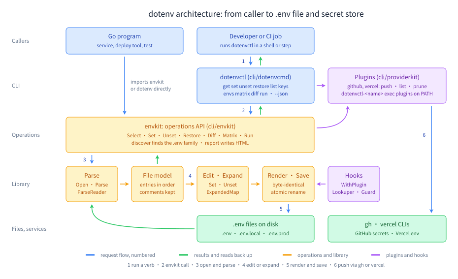

# dotenv documentation

Everything about the `github.com/ubgo/dotenv` library and its command-line companion `dotenvctl`, as plain guides with runnable examples. Every Go code block in these pages is an `Example` function that `go test` compiles and checks, except a few signature excerpts and third-party programs, which are marked as such.

`dotenvctl` is the command-line companion to the [`github.com/ubgo/dotenv`](../README.md) library: every edit is comment-preserving and byte-exact — comments, blank lines, ordering, and quoting style survive anything you do — and the tool never modifies its own process environment.



**On this page:** [Learning path](#learning-path) · [Start from your goal](#start-from-your-goal) · [Install](#install) · [Library guides](#library-guides) · [CLI guides](#cli-guides) · [Go API](#go-api) · [Choosing guides](#choosing-guides) · [Reference](#reference) · [Design promises](#design-promises-hold-everywhere)

## Learning path

Twelve steps from the first command to a full production setup. Each step says what you learn, where to read, and which runnable example to try.

| # | Step | What you learn | Guide | Example |
|---|---|---|---|---|
| 1 | First use of the CLI | install `dotenvctl`, read and change a value from the shell, `-f`, `--json`, exit codes | [Getting started](getting-started.md) | [`ExampleExecute_get`](../cli/dotenvcmd/example_test.go) |
| 2 | Read a file from Go | `Read` vs `Open` vs `Parse` vs `ParseReader`, and what every accessor returns | [Reading](library/reading.md) | [`Example_quickstart`](../example_readme_test.go), [`ExampleRead`](../example_read_test.go) |
| 3 | Entries and syntax | the six entry kinds; quoting, comments, multi-line values, the `:` delimiter, key names, escapes | [Entries and kinds](library/entries.md), [.env syntax](library/syntax.md) | [`ExampleKind`](../example_read_test.go), [`ExampleParse_syntaxQuotes`](../example_syntax_test.go) |
| 4 | Edit without losing anything | `Set`, `SetAfter`, `Unset` / `Restore`, the constructors, `Append` / `Insert*`, `Clone` | [Editing](library/editing.md) | [`ExampleFile_Set`](../example_edit_test.go), [`ExampleFile_Clone`](../example_edit_test.go) |
| 5 | Save safely | atomic writes, file modes, line endings, the trailing newline, `SaveAs` | [Saving](library/saving.md) | [`ExampleFile_Save`](../example_edit_test.go) |
| 6 | Expand references | `${VAR}`, every `${…}` operator, `$$`, nesting, `RequiredError`, opt-in `$(command)` | [Variable expansion](library/expansion.md) | [`ExampleFile_GetExpanded`](../example_expand_test.go), [`ExampleRequiredError`](../example_expand_test.go) |
| 7 | Compare environments | discover the `.env` family, the drift matrix, `diff`, HTML reports | [Multi-environment tools](multi-env.md) | [`ExampleExecute_matrix`](../cli/dotenvcmd/example_test.go), [`ExampleExecute_diff`](../cli/dotenvcmd/example_test.go) |
| 8 | Gate CI and automate | contract gates, deriving prod from staging, the monorepo split, jq, safe edits in scripts | [Recipes](recipes.md) | [`ExampleBuildMatrix`](../cli/envkit/example_test.go) |
| 9 | Extend the library with plugins | environment fallback, decryption, save guards, sandboxed commands, observers, ordering, the firewall | [Plugins](library/plugins.md) | [`ExampleWithPlugin`](../example_plugin_test.go), [`ExampleWithLookup`](../example_plugin_test.go) |
| 10 | Bind typed configuration | the standard library, go-envconfig, caarlos0/env and cfgkit | [Typed configuration](library/typed-config.md) | [`Example_typedConfig`](../example_plugin_test.go) |
| 11 | Sync secrets outward | GitHub Actions secrets, Vercel variables, writing your own exec plugin | [Plugins overview](plugins.md), [GitHub](plugins/github.md), [Vercel](plugins/vercel.md) | [`githubplugin.ExamplePlugin_Command`](../cli/plugins/githubplugin/example_test.go), [`vercelplugin.ExamplePlugin_Command`](../cli/plugins/vercelplugin/example_test.go) |
| 12 | Use the CLI from Go | `envkit` operations, `providerkit` plugins, mounting the built-in plugins, embedding with `dotenvcmd.Execute` | [Go API](go-api.md) | [`ExampleSelectFile`](../cli/envkit/example_test.go), [`ExampleExecute`](../cli/dotenvcmd/example_test.go) |

## Start from your goal

| I want to… | Read | Example |
|---|---|---|
| load configuration in a Go service | [Reading, step 1](library/reading.md#step-1--read-the-values-in-one-call), then [Typed configuration](library/typed-config.md) | [`ExampleRead`](../example_read_test.go) |
| change a value in a script without breaking the file | [`set`](commands.md#set--upsert-values-byte-preserving) | [`ExampleExecute_set`](../cli/dotenvcmd/example_test.go) |
| change a value from Go and keep every comment | [Editing, step 1](library/editing.md#step-1--change-or-add-a-value-with-set) | [`ExampleFile_Set`](../example_edit_test.go) |
| turn a setting off and back on | [`unset`](commands.md#unset--deactivate-a-key) / [`restore`](commands.md#restore--the-inverse-of-unset), or [Editing, steps 3-4](library/editing.md#step-3--turn-a-setting-off-with-unset) | [`ExampleFile_Restore`](../example_edit_test.go) |
| generate a `.env.example` | [Editing, steps 7-8](library/editing.md#step-7--generate-content-with-the-constructors) | [`ExampleFile_Append`](../example_edit_test.go) |
| derive `.env.prod` from `.env.staging` | [Editing, step 9](library/editing.md#step-9--derive-another-environment-with-clone), or the [recipe](recipes.md#derive-envprod-from-envstaging) | [`ExampleFile_Clone`](../example_edit_test.go) |
| see which environments drift | [`matrix`](multi-env.md#matrix--the-drift-table) | [`ExampleExecute_matrix`](../cli/dotenvcmd/example_test.go) |
| fail CI when an environment misses a key | [CI gate recipe](recipes.md#ci-gate-the-build-on-env-completeness) | [`ExampleBuildMatrix`](../cli/envkit/example_test.go) |
| run a command with a file's values | [`run`](commands.md#run--execute-a-command-with-the-files-values) | [`ExampleRun`](../cli/envkit/example_test.go) |
| push secrets to GitHub Actions | [GitHub plugin](plugins/github.md) | [`githubplugin.ExampleNew`](../cli/plugins/githubplugin/example_test.go) |
| push variables to Vercel | [Vercel plugin](plugins/vercel.md) | [`vercelplugin.ExampleNew`](../cli/plugins/vercelplugin/example_test.go) |
| decrypt values or read from a secret store | [Plugins, steps 1-2](library/plugins.md#step-1--fill-missing-references-with-withlookup) | [`ExampleWithValueTransform`](../example_plugin_test.go) |
| stop a plaintext secret from being saved | [Plugins, step 3](library/plugins.md#step-3--refuse-bad-writes-with-withsaveguard) | [`ExampleWithSaveGuard`](../example_plugin_test.go) |
| stay compatible with Docker Compose | [Options for your kind of app](choosing/app-setups.md#docker-compose-compatibility) | [`ExampleEscapeCompose`](../example_syntax_test.go) |
| build my own sync backend | [Which sync backend](choosing/sync-backend.md) | [`ExampleNewPushCmd`](../cli/providerkit/example_test.go) |
| ship `dotenvctl` inside my own binary | [Go API, embedding](go-api.md#embedding-the-cli) | [`ExampleExecute`](../cli/dotenvcmd/example_test.go) |

## Install

```sh
go install github.com/ubgo/dotenv/cli/cmd/dotenvctl@main
```

Or build from a clone: `task cli:build` produces `cli/bin/dotenvctl`.

## Library guides

The `github.com/ubgo/dotenv` package: one file at a time, stdlib only.

| Guide | Covers |
|---|---|
| [Reading a .env file](library/reading.md) | `Read`, `Open`, `Parse`, `ParseReader` and every read accessor, with duplicates and disabled lines |
| [Entries and kinds](library/entries.md) | the `Entry` type, the six `Kind` values, walking `Entries()` |
| [.env syntax](library/syntax.md) | every quoting, comment, delimiter, key and escape rule, shown as input → `Get` → `GetExpanded` |
| [Editing a .env file](library/editing.md) | `Set`, `SetAfter` / `SetBefore`, `Unset` / `Restore`, `Disabled`, `Inherited`, `Append` / `Insert*`, constructors, `Clone` |
| [Saving a .env file](library/saving.md) | atomic `Save`, file modes, line endings, trailing newline, `SaveAs` |
| [Variable expansion](library/expansion.md) | `${VAR}`, every `${…}` operator, `$$`, nesting and cycles, `ExpandedMap`, `RequiredError`, opt-in `$(command)` |
| [Plugins](library/plugins.md) | the six hook capabilities, function options, ordering, the firewall, and checking what was detected |
| [Typed configuration](library/typed-config.md) | binding values to a typed struct with the standard library, go-envconfig, caarlos0/env or cfgkit |

## CLI guides

| Guide | Covers |
|---|---|
| [Getting started](getting-started.md) | install, first commands, the `-f` flag, `--json`, exit codes |
| [Command reference](commands.md) | **every verb** — `get` · `set` · `unset` · `restore` · `list` · `keys` · `run` · `diff` · `envs` · `matrix` · `github` · `vercel` · `plugins` · `completion` — every flag, with real output |
| [Multi-environment tools](multi-env.md) | `envs` discovery, the `matrix` drift table, `diff`, HTML reports, secret masking |
| [Recipes](recipes.md) | complete workflows: CI contract gates, staging→prod cloning, the monorepo prefix split, GitHub and Vercel sync end to end, jq cookbook |
| [Plugins overview](plugins.md) | how plugin namespaces work, shared flags, safety rules, writing an exec plugin |
| [GitHub plugin](plugins/github.md) | pushing env values to GitHub Actions secrets via `gh` |
| [Vercel plugin](plugins/vercel.md) | push, list and prune Vercel environment variables: targets, `--sensitive`, `VERCEL_TOKEN`, CI usage, failure behavior |

## Go API

| Guide | Covers |
|---|---|
| [Go API](go-api.md) | **importing dotenvctl as a library** — envkit operations, providerkit plugin kit, mounting the github/vercel plugins, embedding the CLI with `dotenvcmd.Execute`, helper packages |

## Choosing guides

Decision tables for "which call, option or backend do I need?" — start at [the index](choosing/README.md).

| Guide | Answers |
|---|---|
| [How to read a file](choosing/reading.md) | `Read` vs `Open` vs `Parse` vs `ParseReader`; which accessor |
| [How to edit a file](choosing/editing.md) | upsert vs literal families; `Unset` vs delete; `Save` vs `SaveAs` |
| [Which expansion setup](choosing/expansion.md) | `Get` vs `GetExpanded` vs `ExpandedMap`; operators; escapes; command substitution |
| [Which plugin hook](choosing/plugins.md) | which option or capability for a need |
| [CLI, library or embedding](choosing/cli-or-library.md) | `dotenvctl` vs the library vs `envkit` vs `dotenvcmd.Execute` |
| [Which sync backend](choosing/sync-backend.md) | GitHub vs Vercel vs an exec plugin vs `providerkit` |
| [Options for your kind of app](choosing/app-setups.md) | 12-factor service, CLI tool, CI pipeline, monorepo, Docker Compose |

## Reference

- [Feature index](reference/features.md) — all 122 features, each with its guide section and runnable examples.
- [Library README](../README.md) — the overview, feature support tables, API table, testing and FAQ.
- [CLI README](../cli/README.md) — the CLI pitch and tour.
- Package docs on [pkg.go.dev](https://pkg.go.dev/github.com/ubgo/dotenv), where every `Example` also renders.

## Design promises (hold everywhere)

- **Byte preservation.** Mutating commands change only the entries you name; re-setting a key to its current value is a true no-op — the file is not even rewritten, so watchers see no phantom mtime change.
- **Your process environment is never touched.** `run` builds the child's environment; nothing else goes near `os.Environ`.
- **Secrets stay out of output.** Values are masked (`••••••`) in shareable surfaces (matrix `--values`, JSON, HTML) unless you explicitly pass `--reveal`, and plugin output prints names and actions, never values.
- **Stable machine interface.** `--json` emits one `{"ok":true,"data":…}` / `{"ok":false,"error":{"code","message"}}` object per invocation; exit codes are `0` success, `1` operation failed, `2` usage error (`run` passes the child's exit code through verbatim; `diff` and `matrix --contract` use `1` to signal differences/gaps, like `diff(1)`).
